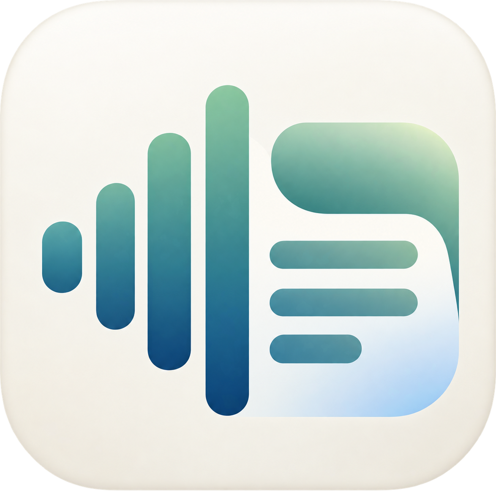

<p align="center"></p>
<h1 align="center">Locaptio</h1>
<p align="center">Local captions, translation & audio recording for Windows 11</p>
<p align="center"><b>日本語</b> · <a href="README.en.md">English</a> · <a href="https://github.com/Kou-256/Locaptio/releases/latest">Download</a> · <a href="https://github.com/Kou-256/Locaptio/issues">Issues</a></p>

Windows 11向けの、ローカル音声認識・英日翻訳・字幕オーバーレイ・録音アプリです。動画や会議の音声を読みながら、必要な文章と音声を保存できます。

> **開発中の個人プロジェクトです。** 現在の画面表示は主に日本語です。英語の利用説明は [English README](README.en.md) を参照してください。精度と速度は音声・モデル・ハードウェアによって変わります。

## できること

- **英語→日本語の翻訳／日本語の文字起こし**を切り替え。
- PC内音声、マイク、指定アプリ、**PC内音声＋マイクの同時入力**。
- 英文を先に表示し、FuguMTの速報訳と任意のQwen3による文脈訳で更新。
- **文字だけが浮かぶ字幕**。言語の配置・色・サイズ・行間を変更可能。
- 本体と字幕の**背景・文字の透明度を個別設定**。初期値は背景透過率70%、文字は不透明度100%の白。
- 全履歴を表示し、上へスクロールした位置を保持。
- UTF-8テキスト保存、**WAV／MP3／M4A録音**。保存先を別々に指定。
- CPU、NVIDIA CUDA、DirectML翻訳、実験的なAMD XDNA 2 NPU認識。
- Windowsライブキャプションが認識した文章の取り込み。

## ダウンロード・必要環境

[**最新版のRelease**](https://github.com/Kou-256/Locaptio/releases/latest) から `Locaptio-<version>-win-x64.zip` をダウンロードし、**ZIP全体を展開**して `Locaptio.exe` を起動してください。exeだけを取り出すと動作しません。

| 項目 | 必要条件 |
| --- | --- |
| OS／CPU | Windows 11 24H2以降、x64。ARM64版は未配布 |
| アプリの実行 | 配布ZIPに.NET／Windows App SDKを同梱 |
| Windows字幕連携のみ | Windowsライブキャプションと対象言語パック |
| Whisper・翻訳・LLM | [uv](https://docs.astral.sh/uv/getting-started/installation/)、初回セットアップ用のネット接続 |
| 空き容量 | ローカルモデル用に10GB以上を目安に確保。追加LLM・GPU/NPU環境はさらに必要 |
| ソースのビルド | [.NET 10 SDK](https://dotnet.microsoft.com/download/dotnet/10.0)。アプリは.NET 8ターゲット。テストには.NET 8 Runtimeも必要 |

配布ZIPは未署名の個人ビルドです。Windowsが警告を表示する場合があります。Releaseの `SHA256SUMS.txt` でチェックサムを確認できます。セットアップはWindowsの保護機能を変更しません。

## 最短で試す：Windowsの日本語字幕を取り込む

PythonやWhisperモデルを準備せずに試せます。

1. `Locaptio.exe` を起動。
2. **設定(S) → 設定を開く… → 音声認識エンジン**で **Windowsライブキャプション連携**を選択。
3. モードを **日本語の文字起こし**、入力を **PC全体の音声**にする。
4. **Start**を押し、開いたWindowsライブキャプションの初回設定を済ませ、認識言語を日本語にする。
5. PCで日本語音声を再生する。

Windows側の字幕は開いたまま使います。連携はWindowsが公開する字幕の文字情報を読む方式で、Microsoftの認識モデルを組み込む方式ではありません。Windows更新や言語設定によって利用できない場合があります。

英日翻訳には次のローカル翻訳モデルの準備も必要です。Windows側の認識言語は英語にしてください。

## Whisper・英日翻訳を準備する

uvをインストールします。例：

```powershell
winget install --id=astral-sh.uv -e
```

PowerShellを開き直し、**展開したLocaptioフォルダー**へ移動して実行します。

```powershell
powershell -ExecutionPolicy Bypass -File scripts/setup.ps1 -SkipBuild
```

Python 3.12環境、Whisperのbase/small、FuguMT翻訳モデルを準備します。ダウンロード・変換には時間がかかります。完了後、設定の **モデル・推論環境** にこのLocaptioフォルダーを指定してください。

- **アプリ単独の認識**：認識エンジンをWhisperにしてStart。
- **Windows認識＋英日翻訳**：Windows連携、Windowsの認識言語を英語、本アプリを英語→日本語にしてStart。
- LLM未導入の場合は **ローカルLLMで文脈を踏まえて翻訳** をOFFにするとFuguMTだけで利用できます。

## 基本操作

| 操作 | 動作 |
| --- | --- |
| Start | 新しい文字起こしセッションを開始。必要な前の文章は先に保存 |
| Stop | **文字起こしと録音を両方停止**し、録音を確定 |
| Clear | 表示・保存用テキスト履歴を消去。録音は継続 |
| 字幕 | 字幕だけのウィンドウを開き、本体を最小化。本体にも文章を保持 |
| テキスト保存 | 現在のセッション全体をUTF-8のTXTへ保存 |
| 録音チェック | 保存先を選んで録音開始。外すと録音だけを停止 |
| 入力・モード変更 | 字幕履歴を消去。入力変更時の録音は新ファイルへ分割 |

字幕は認識の更新が始まると表示し、無更新の時間が続くと自動で隠れます。字幕の背景をドラッグして移動でき、Escapeで閉じられます。翻訳やAI補正は同じ行へ反映します。

### マイク＋PC音声の同時入力

**PC内音声＋マイク（既定の機器・同時入力）**を選び、録音にチェックしてStartを押します。既定の再生機器とマイクを各50%で混ぜ、片方が無音でも継続します。

この入力では、Windows連携を選んでいても**自動でWhisperを使用**します。Whisperモデルが必要です。話者の分離・エコー除去は行いません。スピーカー音をマイクでも拾う場合はヘッドホンが役立ちます。

## 速度・精度・モデルの選び方

| 目的 | 設定・モデル |
| --- | --- |
| Windowsと同じ認識結果 | Windows連携。入力・認識言語・認識デバイスはWindows側に従う |
| 軽いWhisper認識 | base。tinyはさらに軽いものの、日本語の誤りが増える場合あり |
| 速度と精度のバランス | small |
| GPUで精度優先 | large-v3-turbo。別途ダウンロードが必要 |
| 先に表示して後で改善 | 高速文字起こし・リアルタイム速報＋独立した高精度更新 |
| 英日翻訳 | FuguMTの速報＋任意のQwen3による文脈・用語メモを使った翻訳 |
| 認識原文の後補正 | 文脈AI補正をON。LLMは別途導入。初期値はOFF |

補正・翻訳は誤りを含みます。速度はモデル・PC負荷・発話長・初回読み込みに依存し、Windowsと同じモデルや速度を保証しません。

### オプションのセットアップ

リポジトリまたは展開先のルートから、必要なものだけ実行します。

```powershell
# NVIDIA用ローカルCUDA DLL。NVIDIAドライバーは別途必要
powershell -ExecutionPolicy Bypass -File scripts/setup-cuda.ps1
# GPU向け高精度Whisper
powershell -ExecutionPolicy Bypass -File scripts/setup-speech.ps1 -Model large-v3-turbo
# DirectMLのGPU翻訳
powershell -ExecutionPolicy Bypass -File scripts/setup-directml.ps1
# Qwen3-4B Q4_K_M + llama.cpp（Vulkan）
powershell -ExecutionPolicy Bypass -File scripts/setup-llm.ps1
# LLMをCPUのみで使う場合
powershell -ExecutionPolicy Bypass -File scripts/setup-llm.ps1 -Backend cpu
# 実験的AMD Ryzen AI / XDNA 2 NPU用Whisper-small
powershell -ExecutionPolicy Bypass -File scripts/setup-amd-speech.ps1
```

AMD NPU経路はRyzen AI 9 HX 370で実機検証した実験的機能です。Windows ML・対応ドライバーが必要で、初回コンパイルは長時間かかる場合があります。NPUで行うのは専用Whisper-smallの認識で、翻訳・LLMはGPU/CPUです。すべてのPCでの動作は未確認です。[モデルとbackendの詳細](docs/model-selection.md)も参照してください。

## 保存とプライバシー

- 初回セットアップではパッケージ・モデル等をダウンロードします。**通常のローカル推論にクラウドAPIやAPIキーは使いません。**
- 録音・テキスト保存は明示的に操作したときだけ実行。文字起こしの自動保存はありません。
- 保存先を別々に設定できます。同期フォルダーでは、そのサービスがファイルを同期する可能性があります。
- 設定は `%LOCALAPPDATA%/Locaptio/settings.json`。旧版設定を初回のみ互換読み込みします。
- WAVは16kHz／16bit／mono、約115MB/時。MP3/M4Aは停止後に変換し、失敗時は元の `.recording.wav` を残します。
- 本体の履歴に行数制限はありません。文字データのメモリは利用時間に応じて増えます。音声・描画のバッファは制限しています。

## 困ったとき

| 症状 | 確認すること |
| --- | --- |
| モデルなし・Start不可 | setupの完了、モデル・推論環境のフォルダー、認識エンジン |
| Windows字幕が出ない | Windows字幕を開いたままにし、認識言語をモードと合わせる |
| マイク・指定アプリで認識できない | Whisperを選ぶ。Windowsのマイク利用許可・入力機器を確認 |
| CUDAが使えない | ドライバー・setup-cuda.ps1・画面のbackendを確認。CPUも利用可能 |
| 表示が遅れる | base等の軽い速報モデル、GPU設定、他の高負荷処理を確認 |
| MP3/M4Aの停止が遅い | 変換の完了待ち。すぐ確定したい長時間録音にはWAVを選ぶ |
| 移動後に起動できない | DLL・Assets・bridgeを含むフォルダー全体を移動する |

問題は [Issues](https://github.com/Kou-256/Locaptio/issues) へ。OS・入力モード・エンジン・モデル・backend・再現手順を添えてください。個人情報を含む音声や全文ログの公開は不要です。

## 開発・ビルド

```powershell
git clone https://github.com/Kou-256/Locaptio.git
cd Locaptio
# アプリのビルド。モデル準備は別途
dotnet build src/WinUI/Locaptio.WinUI.csproj -c Release -p:Platform=x64
# ビルドとモデルをまとめて準備する場合
powershell -ExecutionPolicy Bypass -File scripts/setup.ps1
# ソースから起動
powershell -ExecutionPolicy Bypass -File scripts/run.ps1
# 配布ZIPの生成
powershell -ExecutionPolicy Bypass -File scripts/build-portable.ps1
```

ソリューションは `Locaptio.sln`。WinUI 3が現行UI、`src/App` のWPF版は互換・検証用です。`scripts/build-msix.ps1` でMSIXを生成できますが、インストールには適切な署名が別途必要です。公開Releaseは証明書の追加が不要なZIPを基本とします。

[アーキテクチャ](docs/architecture.md) · [モデル](docs/model-selection.md) · [テストと検証範囲](docs/testing.md) · [変更履歴](CHANGELOG.md)

## ライセンス

Locaptioのソースは [MIT License](LICENSE)。モデル・依存物は各ライセンスに従います。モデル本体・Python環境・CUDA/NPUライブラリはリポジトリと配布ZIPに同梱せず、セットアップ時に別途取得します。[Third-party notices](THIRD_PARTY_NOTICES.md) を確認してください。
